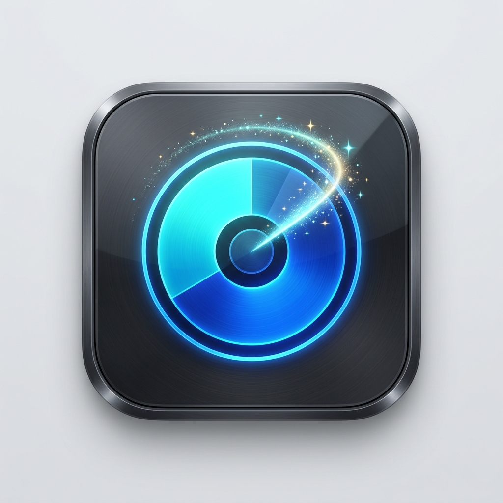

<p align="center">
  
</p>

<h1 align="center">CleanMac</h1>

<p align="center">
  <b>Aplikasi macOS native (SwiftUI) modern untuk menganalisis penyimpanan disk, mendeteksi aplikasi & data berukuran besar, dan membersihkan file sampah sistem.</b>
</p>

---

## ✨ Fitur Utama

- 💾 **Storage Overview Real-time**: Menampilkan kapasitas total disk, ruang terpakai (*used*), dan ruang kosong (*free*) secara akurat.
- 📂 **Analisis Semua Folder (System Data & User)**:
  - Memindai folder utama sistem dan pengguna termasuk `Application Support`, `Containers`, `Developer`, `iCloud Drive`, dll.
  - **Eksplorasi Subfolder (Drill-Down)**: Klik tanda panah `>` pada folder apa pun untuk melihat rincian subfolder mana di dalamnya yang paling memakan tempat.
- 📦 **Deteksi Aplikasi Besar**: Memindai direktori `/Applications` dan `~/Applications`, menghitung ukuran bundle sebenarnya secara rekursif, dan menampilkan ikon aplikasi asli macOS.
- 📁 **Deteksi File & Folder Data Besar**: Memindai folder `Downloads`, `Documents`, `Desktop`, `Movies`, dll. untuk file/folder berukuran besar (>10 MB), termasuk direktori developer seperti `node_modules`, `build`, dan `.gradle`.
- 🧹 **Pembersih Sampah (Junk Cleaner)**:
  - Cache aplikasi (`~/Library/Caches`)
  - Log sistem lama (`~/Library/Logs`)
  - Xcode DerivedData build cache
  - Installer bekas (`.dmg` / `.pkg`)
  - Tempat sampah (`.Trash`)
  - Cache package manager (`.npm`, `.cargo`, dll)
  - Fitur **Checkbox & Hapus Yang Dipilih** sekaligus atau satuan.
- 🗑️ **Penghapusan Aman (Move to Trash)**: Setiap file/folder/aplikasi dapat dipindahkan ke Trash langsung dari aplikasi dengan dialog konfirmasi keamanan.
- 📊 **Visualisasi Kategori**: Menggunakan **Swift Charts** native untuk menampilkan distribusi penyimpanan berdasarkan kategori.
- 🔍 **Pencarian & Filter Cepat**: Filter berdasarkan kategori dan pencarian instan nama file/aplikasi.

---

## 🛠️ Tech Stack

- **Bahasa**: Swift 5.9+ / Swift 6
- **UI Framework**: SwiftUI + Swift Charts
- **Platform**: macOS 13.0+ (Ventura, Sonoma, Sequoia)
- **Build System**: Swift Package Manager (SPM) tanpa dependensi pihak ketiga

---

## 🚀 Cara Menjalankan

### Cara 1: Menjalankan Script Otomatis
```bash
git clone https://github.com/anditiayo/cleanmac.git
cd cleanmac
chmod +x run.sh
./run.sh
```

### Cara 2: Build Manual
```bash
swift build -c release
open CleanMac.app
```

---

## 📄 Lisensi

MIT License © 2026 yogianditia
